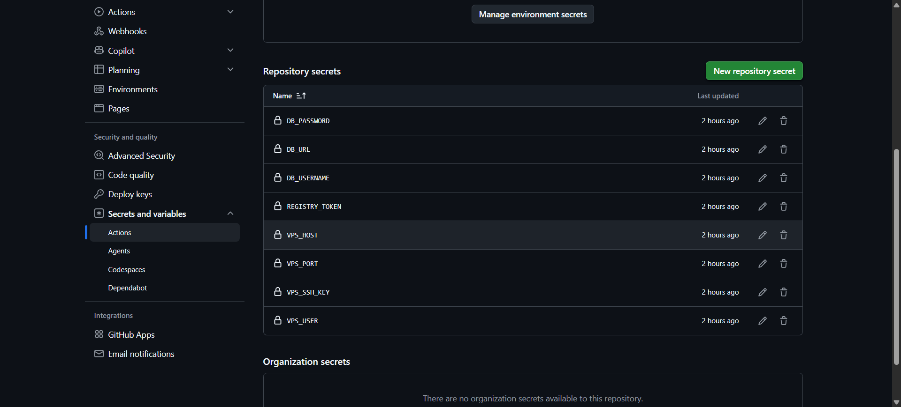

# BT04 - Khai báo GitHub Secrets và cấu hình Đăng nhập Container Registry

## 1. Tạo Personal Access Token (classic)

Truy cập GitHub -> Settings -> Developer settings -> Personal access tokens -> Tokens (classic) -> Generate new token (classic), chọn scope `write:packages` và tạo token.

## 2. Khai báo Repository Secret

Vào Repository SS11-BT04 -> Settings -> Secrets and variables -> Actions -> New repository secret, đặt tên là `REGISTRY_TOKEN` và dán token vừa tạo.

```text
Settings -> Secrets and variables -> Actions

Repository secrets
  REGISTRY_TOKEN    Updated 14/10/2026 09:52
```

## 3. Nội dung tệp .github/workflows/ci.yml

Bổ sung bước đăng nhập Container Registry vào cuối Job test:

```yaml
name: Java Spring Boot CI (Gradle)

on:
  push:
    branches: [ "main" ]

jobs:
  test:
    name: Run Unit Tests
    runs-on: ubuntu-latest

    steps:
      - name: Checkout mã nguồn
        uses: actions/checkout@v5

      - name: Thiết lập môi trường Java JDK 17
        uses: actions/setup-java@v5
        with:
          java-version: '17'
          distribution: 'temurin'
          cache: 'gradle'

      - name: Cấp quyền cho Gradle Wrapper
        run: chmod +x gradlew

      - name: Thực thi JUnit Test với Gradle
        run: ./gradlew test

      - name: Đóng gói tệp JAR với Gradle
        run: ./gradlew bootJar

      - name: Lưu trữ thành phẩm JAR Artifact
        uses: actions/upload-artifact@v4
        with:
          name: app-jar
          path: build/libs/*.jar

      - name: Đăng nhập vào GitHub Container Registry
        uses: docker/login-action@v3
        with:
          registry: ghcr.io
          username: ${{ github.actor }}
          password: ${{ secrets.REGISTRY_TOKEN }}
```

## 4. Push code lên GitHub

```bash
devops@0310263186:~/demo$ git add .github/workflows/ci.yml
devops@0310263186:~/demo$ git commit -m "ci: đăng nhập GHCR bằng secret REGISTRY_TOKEN"
[main 4a1c8e2] ci: đăng nhập GHCR bằng secret REGISTRY_TOKEN
 1 file changed, 6 insertions(+)
devops@0310263186:~/demo$ git push origin main
To github.com:IT209-K24-LePhuThinh/SS11-BT04.git
   b93d207..4a1c8e2  main -> main
```

## 5. Log bước Đăng nhập Registry trên tab Actions

```text
Java Spring Boot CI (Gradle) #5
Run Unit Tests    Success    1m 05s

Run docker/login-action@v3
  Logging into ghcr.io...
  Login Succeeded
```

Bước đăng nhập hiển thị dòng `Login Succeeded`, xác nhận token trong secret `REGISTRY_TOKEN` được sử dụng để xác thực thành công với GitHub Container Registry.

## 6. Ảnh chụp màn hình


